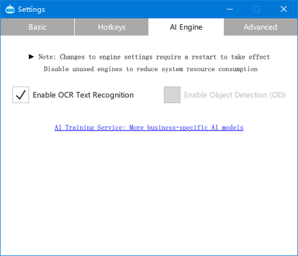

# 本地 AI 图像

首先在软件设置中开启本地AI识别功能模块，然后重启软件生效。

## aiOcr 文字识别

@param {string} imagePath 空或者screen 为电脑屏幕; 或者本地图片的绝对路径;

@param {number} x 可选 剪裁起始点 左上角开始

@param {number} y 可选 剪裁起始点

@param {number} width 可选 剪裁宽度

@param {number} height 可选 剪裁高度

@returns {array} AI OCR识别的json结果 包含准确率的评分和中点位置 格式： `[{text:'A',score:'0.319415',x:100,y:200},...]`

##  findText 寻找文字

findText 屏幕查找定位文字

查找文字，注：此功能受电脑性能影响，低配电脑可能速度较慢。 需要小瓶RPA客户端版本 > V2024.5

@param {string} inputTxt

@param {number} fromX=0 可选，查找开始的开始横坐标

@param {number} fromY=0 可选，查找开始的开始纵坐标

@param {number} width=-1 可选，搜索宽度

@param {number} height=-1 可选，搜索高度

@returns {OcrItem|false} 返回 json 结果：`{text,score,x,y}`，x,y 坐标相对于屏幕左上角的原点；未找到返回 false

## waitText 等待文字

等待屏幕指定文字出现

@param {string} inputTxt 搜索文字

@param {number} fromX 可选，查找开始的开始横坐标

@param {number} fromY 可选，查找开始的开始纵坐标

@param {number} width 可选，搜索宽度

@param {number} height 可选，搜索高度

@param {function} intervalFun 回调函数，用于中途判断是否继续等待，返回值为 stopWait 时，停止等待

@param {number} timeOut 超时时间，单位秒，默认20

@returns {OcrItem|false} 找到则返回文字位置信息；超时抛错并自动截图到 我的图片

## aiObject 物体识别

AI 物体识别 已经从经典算法升级为AI模型预测，企业版可脱网使用 V2024.8 以上版本有效

调试：软件根目录会生成 debug/Ai_ObjectDetect.png 文件

@param {number} minimumScore 相似度阈值，默认0.5

@param {number} x 可选 查找范围起始横坐标

@param {number} y 可选 查找范围起始纵坐标

@param {number} width 可选 查找宽度

@param {number} height 可选 查找高度

@returns {array} AI 物体识别的 json 结果 包含准确率的评分 格式： `[{x:100,y:100,width:150,height:150,score:0.86,class:'分类名'},...]`

