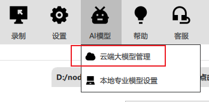

# AI 大模型（云模块）

小瓶RPA 云端模块，AI在线大模型

1. 此模块不是必须模块 ，云端模块不影响本地模块的独立运行
2. 此模块功能需要登录并激活云端模块。碍于成本因素，部分功能需要充值计费才能使用

调用方式：pbottle.cloud.XXX()

token定价：https://rpa.pbottle.com/a-14065.html

## 大语言模型 cloud_GPT

小瓶RPA整合的云端大语言答案生成模型

别名：`cloud.GPT`

@param {string} question 提问问题，如：'今天是xx日，你能给我写首诗吗？'

@param {number} modelLevel 模型等级，不同参数大小不同定价，默认 0 为标准模型。0为低价模型；1为性价比模型；2为旗舰高智能模型；

@param {AiOptions} options AI输入选项：
- `response_format` 云端模型输出格式，默认："text"，可选 "json_object" JSON格式
- `temperature` 模型温度，默认：0.75，取值范围 [0-2)
- `enable_search` 联网搜索开关，默认关闭。开启后只会根据问题自动判断是否联网，可在问题中添加联网搜索关键词，如："联网搜索：xxxx"

@returns {Answerinfo} JSON内容格式 `{content:'结果',tokens:消耗token的数量}`

示例：GPT问题答案AI生成演示.js

## 图像大模型 cloud_GPTV

小瓶RPA整合的云端图像分析大模型

别名：`cloud.GPTV`

@param {string} question 提问问题，如：'分析这个图片的内容'

@param {string} imagePath 上传图片的路径，如：'c:/test.jpg'

@param {number} modelLevel 模型等级，不同参数大小不同定价，默认 0 为标准模型。

@returns {Answerinfo} JSON内容格式 `{content:'结果',tokens:消耗token的数量}`

示例：GPT图像解析示例.js

## 屏幕大模型 cloud_GPTA

小瓶RPA整合的云端图像分析大模型，直接识别并操作屏幕（自动截图 → 分析 → 移动鼠标 → 点击）

别名：`cloud.GPTA`

@param {string} action 操作类型：'点击'|'双击'|'右键'，默认 '点击'

@param {string} question 提问问题，如：'桌面微信图标'