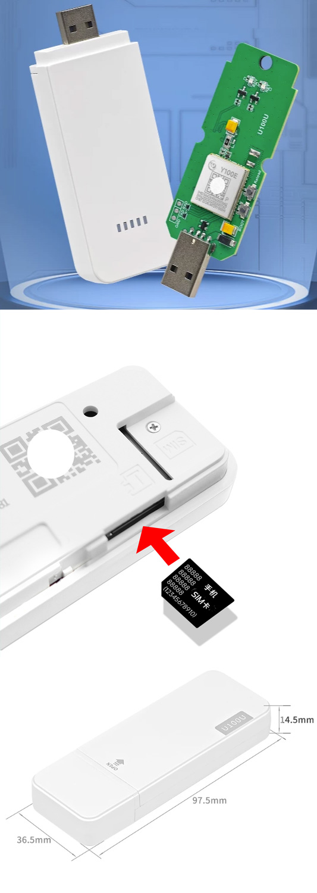

# 短信验证码（SMS Code）自动化工具

优先选择记住登录状态、U盾、定时刷新等方法保持用户权限的会话。

SMS verification code

## 人工辅助 半自动化方案

流程如下：

1. 小瓶RPA自动输入手机号
2. 点击发送短信验证码
3. 管理员手机接收短信验证码并输入
4. 完成验证！！

*提示：一般系统都有记住登录状态功能，请优先勾选，一台电脑只需登录一次。*

## 硬件短信接收器 全自动化方案

需要购买短信小瓶RPA短信验证码接收器（4G全网通模块），并插入目标手机号的SIM卡。

*短信验证码接收器不需要联网，只需要插入SIM卡，即可接收短信验证码。*

**流程步骤：**

1. 电脑插入短信验证码接收器（无人值守）
2. 小瓶RPA自动输入手机号，并点击发送短信验证码
3. 小瓶RPA自动从接收器接收短信验证码
4. 输入验证码，RPA操作完成验证
